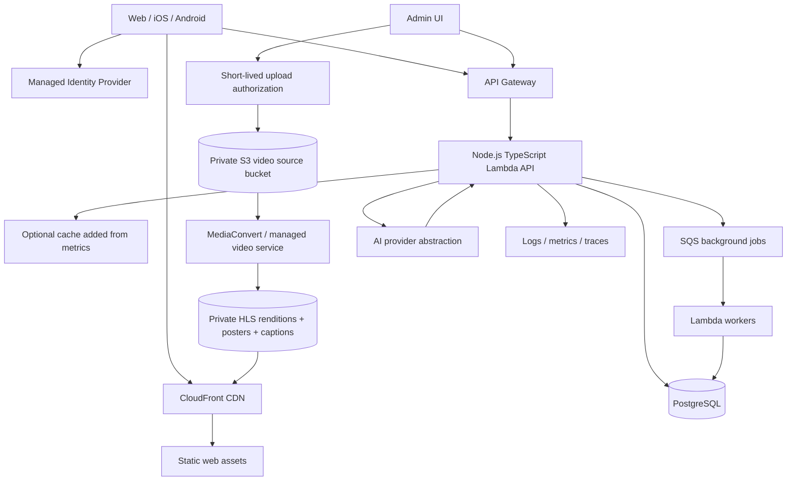

# 02 — Architecture and Scalability

## 1. Architecture principle

Start with a **modular monolith** and managed services. Millions of users are a future capacity goal, not a reason to begin with dozens of services. Keep domain modules and interfaces clean; split a module only when traffic, team ownership, deployment isolation, or operational evidence justifies it.

## 2. Logical architecture

## 3. Frontend

- **Expo + React Native + React Native Web** with TypeScript.
- Expo Router for navigation and web routes.
- Shared packages: `packages/domain`, `packages/api-client`, `packages/ui` where practical.
- Use TanStack Query for server-state caching and retries; keep UI state local.
- Use a platform-aware player abstraction:
  - Web: HTML5 video/HLS-compatible player.
  - iOS/Android: `expo-video` or a currently supported Expo-compatible player.
  - Expose one interface such as `VideoPlayerAdapter`, but implement/test platform differences separately.
- Ensure web builds work with server/CDN routing fallback for deep links.
- Avoid assuming browser APIs exist in native code. Isolate platform-specific modules with `.web.tsx`, `.native.tsx`, or adapter files.

## 4. Backend

- Node.js LTS + TypeScript.
- Use a modular monolith: Fastify or NestJS. For a compact Lambda deployment, Fastify with a Lambda adapter is a reasonable choice; choose one framework and do not mix both.
- Suggested modules:
  - `auth`
  - `catalog`
  - `stories`
  - `episodes`
  - `playback`
  - `favorites`
  - `search`
  - `admin`
  - `ai-discovery`
  - `analytics`
- Validate all external input with a schema library such as Zod.
- Generate OpenAPI docs from route schemas where supported.
- Use structured logs and correlation/request IDs.
- Enforce authorization in the API, not just by hiding frontend controls.

## 5. Data and media

- PostgreSQL stores metadata, users/profile references, favorites, playback progress, content rights, moderation/review state, and audit records.
- Do not store binary video in PostgreSQL.
- S3 stores source uploads and generated renditions. Keep source bucket private.
- CloudFront delivers HLS manifests, video segments, posters, and caption files.
- Prefer HLS adaptive bitrate (multiple resolutions/bitrates) rather than a single large MP4. For an MVP with very few videos, a managed video platform can reduce transcoding/packaging work; retain an abstraction for provider URLs and webhooks.
- Use short-lived signed upload URLs for admin uploads. Validate file size, media type, and checksum; scan where supported; do not trust filename or client MIME alone.
- If content is public and licensed for public access, CDN URLs may be public. If access is restricted, use signed cookies/URLs and verify entitlement server-side.

## 6. Serverless request flow

1. Client obtains an access token from Cognito.
2. Client calls API Gateway with bearer token.
3. Gateway authorizes JWT where supported; backend validates claims and maps stable identity-provider subject to app user.
4. API executes a short database transaction using a managed PostgreSQL connection strategy.
5. For long-running work (transcoding orchestration, AI metadata generation, analytics aggregation), API enqueues a job and returns quickly.
6. Worker handles retries idempotently; failed jobs go to a dead-letter queue and can be replayed after inspection.

### PostgreSQL + Lambda cautions

- Lambda concurrency can overwhelm PostgreSQL connections. Use RDS Proxy where compatible, or Aurora PostgreSQL Serverless v2 with an appropriate proxy/pooling strategy.
- Keep transactions short and use migrations.
- Set sensible Lambda concurrency limits and API rate limits.
- Use indexes and pagination; never return an unbounded episode or event list.
- Avoid serverless scale-to-zero assumptions for PostgreSQL; minimum capacity and connection behavior affect cost/latency.

## 7. Scaling path

### Stage A — MVP (0 to early traction)
- One frontend deployment, one modular API, one PostgreSQL database, S3 + CDN, Cognito, SQS workers.
- Cursor-based pagination, query/index review, structured logs, basic dashboards.
- No Redis unless measurement proves a cache is needed.

### Stage B — Growing audience
- CDN handles most media bandwidth.
- Add database read replicas only if read pressure and query patterns warrant it.
- Add Redis/ElastiCache only for measured hot metadata, rate-limit coordination, or expensive repeat queries.
- Add search service (OpenSearch or managed equivalent) if PostgreSQL full-text search is insufficient.
- Separate analytics/event ingestion from transactional requests; aggregate asynchronously.
- Add per-endpoint throttles, abuse detection, and cost alarms.

### Stage C — High scale / millions of users
- Capacity-test API concurrency, database connections, popular content, login bursts, and event volume.
- Partition or archive high-volume playback/event tables if evidence warrants it.
- Move recommendations and analytics into separate workers/services only when independent scaling/ownership is useful.
- Consider multi-region read delivery and disaster recovery. Keep writes single-region initially unless business requirements justify active-active complexity.
- Use CDN for video; do not proxy video bytes through the Node API.
- Define RPO/RTO and test backup restore and regional recovery.

## 8. AI integration boundaries

- AI provider accessed through `AiProvider` interface; do not couple the domain to one model vendor.
- Initial uses: generate draft synopsis/tags/caption translations; natural-language content discovery; explain why a recommendation fits.
- Search/recommendation must degrade gracefully if AI is unavailable. Use deterministic SQL filters/ranking as fallback.
- Use only consented/minimized profile and event data. Do not send email, phone, raw tokens, or sensitive personal data to the model.
- Do not let AI directly publish content, change payment entitlements, or run arbitrary SQL. Human approval is required for editorial content.
- Log model/provider/version, latency, estimated cost, and feedback; avoid storing raw sensitive prompts unnecessarily.

## 9. Key metrics

- API: p50/p95/p99 latency, error rate, throttles, cold starts, concurrency.
- Database: connections, CPU, memory, query latency, locks, storage, replica lag.
- Media: startup time, playback error rate, rebuffer ratio, bitrate, completion.
- Product: play starts, 25/50/75/100% completion, search success, favorites, returning viewers.
- AI: latency, fallback rate, thumbs up/down, cost per request, hallucination/review rejection rate.
- Business: cost per watch-hour, retention, conversion (if monetization is added).
